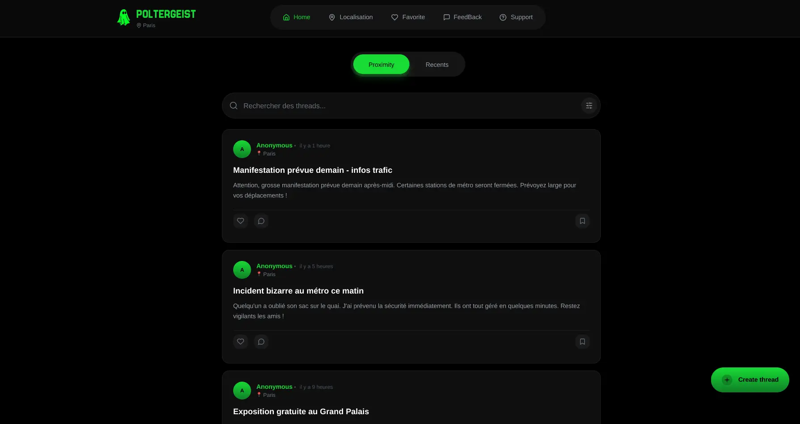
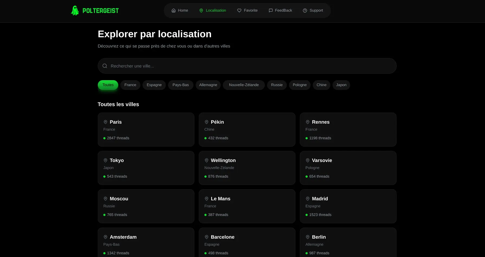
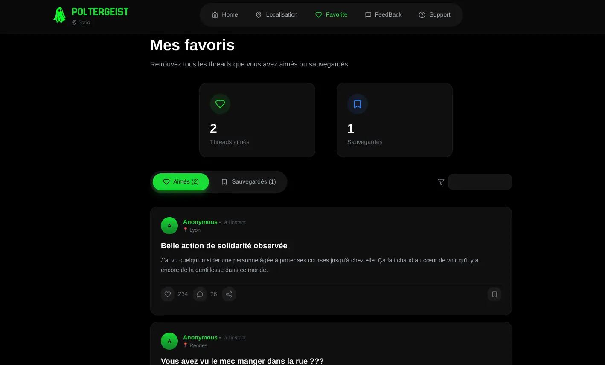

Minimal features : little selection of avatars that are variants of the website's logo,
ability to sort posts based on recentness rather than location, ability to leave feedback on the site etc.

There is obviously nothing profile/account related since the site is made to be interacted with anonymously, no paying version/premium (for now)